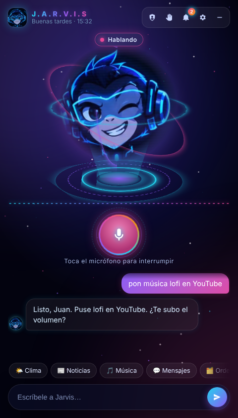
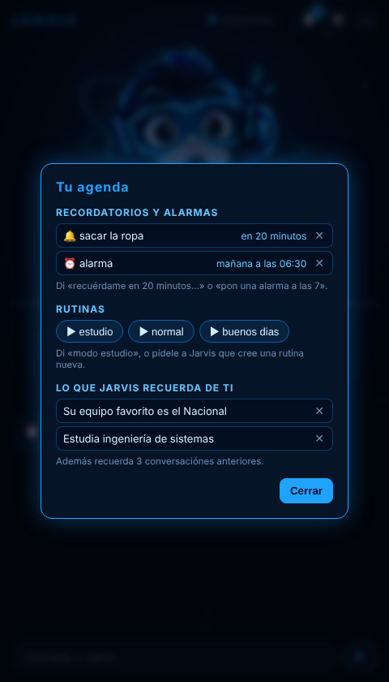

# Jarvis 🐒

Asistente personal para tu portátil con Windows. Te escucha por voz, te responde con una voz
masculina natural y tiene el avatar del mono holográfico de tu diseño en una escena 3D que se
mueve con su voz y cambia de expresión según lo que está haciendo.

Las órdenes del computador funcionan **sin internet**. Si añades una clave de Claude, además
puede **conversar contigo** de cualquier tema y entender órdenes dichas con tus propias palabras.

 

## Qué hace (versión 1)

| Dices… | Jarvis… |
|---|---|
| «Jarvis» | Despierta y te escucha (cara de sorpresa) |
| «Jarvis, busca el archivo tarea» | Busca en Escritorio, Documentos, Descargas, Imágenes, Música, Videos y OneDrive |
| «Abre el dos» | Abre el resultado número 2 de la última búsqueda |
| «Abre la calculadora» / «abre Chrome» / «abre Word» | Abre la aplicación (busca en todas las del menú Inicio) |
| «Abre la foto playa» | Si hay un solo archivo con ese nombre, lo abre directamente |
| «Elimina el uno» | Pregunta «¿Seguro?» y solo si dices **sí** lo manda a la **Papelera** |
| «Revisa la seguridad» | Te dice si Windows Defender y la protección en tiempo real están activos |
| «Bloquea el equipo» | Bloquea la sesión de Windows |
| «¿Qué hora es?» / «¿Qué día es?» | Te lo dice |
| «Duerme» | Se pone en modo dormido hasta que vuelvas a decir «Jarvis» |
| «Ayuda» | Te dice lo que sabe hacer |

También puedes **escribir** en la caja de abajo o tocar el **micrófono del centro**
(si Jarvis está hablando, tocarlo lo interrumpe).

Después de responder, Jarvis **sigue escuchando unos segundos** para que la charla fluya sin
repetir «Jarvis» cada vez (se puede apagar en Ajustes ⚙).

## Conversar con Claude (opcional)

Con Claude, Jarvis deja de ser solo un ejecutor de órdenes: charla contigo, responde preguntas,
recuerda lo que hablaron en la conversación y entiende frases como «búscame las fotos que bajé
de la galería» aunque el micrófono las entienda a medias. También puede usar las órdenes del
computador por ti (buscar, abrir, revisar la seguridad...). Para borrar, **siempre** tienes que
decir «sí» tú mismo.

Cómo activarlo:

1. Entra en <https://console.anthropic.com>, crea una cuenta y carga saldo (Billing). Es de pago
   por uso: cada respuesta corta cuesta alrededor de uno o dos centavos de dólar con el modelo que usa
   Jarvis (`claude-opus-5-5`, configurable en `jarvis/config.py`).
2. En **API Keys** crea una clave (empieza por `sk-ant-`).
3. En Jarvis toca ⚙ **Ajustes**, pégala en «Clave de Claude» y pulsa **Guardar**.

La clave se guarda solo en tu computador (`%LOCALAPPDATA%\Jarvis\ajustes.json`).
Lo que hablas con Claude viaja por internet a Anthropic; las órdenes locales no.
Si no hay internet o se acaba el saldo, Jarvis te lo dice y sigue haciendo las órdenes locales.

### Recordatorios, alarmas y temporizadores (sin internet)

| Dices… | Jarvis… |
|---|---|
| «Avísame en 20 minutos que saque la ropa» | Te lo recuerda en 20 minutos, en voz alta |
| «Recuérdame mañana a las 8 llamar a mamá» | Te lo dice mañana a las 8:00 |
| «Pon una alarma a las 6 y media» | Suena a las 6:30 (y se repite si no le haces caso) |
| «Pon un temporizador de 5 minutos» | Te avisa cuando acabe |
| «¿Qué recordatorios tengo?» | Te los lee numerados |
| «Cancela el recordatorio dos» / «cancela todos los recordatorios» | Los quita |

Se guardan en el disco: si apagas el portátil, al volver a encenderlo Jarvis te dice los que
vencieron mientras estaba apagado. La campana 🔔 de arriba muestra cuántos hay y te deja quitarlos.

### Rutinas (sin internet)

| Dices… | Jarvis… |
|---|---|
| «Modo estudio» | Abre Word, Chrome y Spotify, silencia las notificaciones y te avisa en 25 minutos para descansar |
| «Termina el modo estudio» / «modo normal» | Vuelve a activar las notificaciones |
| «Buenos días» | Te dice el día, la hora y tus recordatorios de hoy |
| «¿Qué rutinas tengo?» | Te las dice |

Con Claude puedes crear rutinas nuevas hablando: «crea un modo juego que abra Steam y Discord y
me avise en una hora». También puedes editarlas a mano en `%LOCALAPPDATA%\Jarvis\rutinas.json`.

### Memoria

| Dices… | Jarvis… |
|---|---|
| «Recuerda que mi equipo favorito es el Nacional» | Lo guarda para siempre |
| «¿Qué sabes de mí?» | Te dice lo que tiene anotado |
| «Olvida que…» | Lo borra |

Con Claude, además, guarda solo lo importante que le cuentas, hace un resumen de cada conversación
para acordarse la próxima vez, y puede buscar en lo que hablaron otros días («¿qué te dije la
semana pasada de mi examen?»). Todo se guarda solo en tu portátil, en `%LOCALAPPDATA%\Jarvis\`.
En la campana 🔔 ves lo que recuerda y puedes borrar cada dato.

### Expresiones del avatar

| Estado | Cara |
|---|---|
| En espera | Normal |
| Te está escuchando | Sorprendido |
| Pensando | Pensando |
| Respondiendo bien | Riendo / Guiño |
| Pide confirmación para borrar | Preocupado |
| Bloquea algo peligroso | Enojado |
| No encontró nada o falló | Triste |
| Modo dormido | Dormido |

Las imágenes están en `jarvis/ui/assets/expresiones/`. Si quieres cambiar alguna, reemplaza el PNG
con el mismo nombre.

## Privacidad y seguridad

- **Sin clave de Claude, nada sale de tu computador.** El reconocimiento de voz (Vosk) y la voz
  (Piper) funcionan sin internet. Solo se usa internet al instalar, para descargar los modelos.
- Con clave de Claude, solo lo que no es una orden local se envía a Claude para conversar.
- **Nunca borra para siempre**: todo va a la Papelera de reciclaje, y siempre pregunta antes.
- Si la respuesta no es un «sí» claro, **no borra nada**.
- Se niega a borrar dentro de Windows, Archivos de programa, AppData ni la carpeta de Jarvis.
- Cada acción queda anotada en `%LOCALAPPDATA%\Jarvis\registro.log` para que puedas revisarla.

## Instalación (una sola vez)

1. Instala **Python 3.10 o superior** desde <https://www.python.org/downloads/>.
   En el instalador marca la casilla **«Add python.exe to PATH»**.
2. Descarga este proyecto (botón verde **Code → Download ZIP** en GitHub) y descomprímelo,
   por ejemplo en `Documentos\Jarvis`.
3. Haz doble clic en **`instalar.bat`**. Tarda unos minutos: instala las librerías y descarga
   el reconocimiento de voz en español (unos 40 MB) y la voz de Jarvis (unos 110 MB).

¿Ya tenías la versión anterior? Reemplaza los archivos y vuelve a ejecutar `instalar.bat`:
solo descarga lo nuevo.

## Uso

- Doble clic en **`iniciar.bat`**. Aparece la ventana del mono y Jarvis te saluda.
- Di **«Jarvis»** y después tu orden, o todo seguido: «Jarvis, abre la calculadora».
- Si cierras la ventana, Jarvis **sigue escuchando en segundo plano**. Lo verás como un icono
  del mono junto al reloj de Windows (puede estar en la flechita ^). Clic derecho → **Salir** para apagarlo.
- ¿Quieres que arranque solo al encender el portátil? Doble clic en `scripts\inicio_automatico.bat`.
- Si algo no funciona, abre **`iniciar_con_consola.bat`**: verás los mensajes de error.

### Consejos para la voz

- Habla claro y a distancia normal del micrófono.
- El modelo pequeño a veces entiende «Jarvis» como «yarvis» o «jarbis»; ya están contemplados en
  `jarvis/config.py` (`VARIANTES_ACTIVACION`). Si te entiende otra cosa, añádela ahí.
- La voz de Jarvis es **Piper** (`es_MX-claude-high`), una voz neuronal masculina que suena humana
  y funciona sin internet. En Ajustes puedes cambiar a «Más natural, con internet», que usa la voz
  de Microsoft Gonzalo (Colombia) y necesita conexión. Si ninguna funciona, usa la voz de Windows.

## Personalizar

Todo lo configurable está en `jarvis/config.py`: tu nombre, la palabra de activación, las carpetas
donde busca y cuánto tiempo espera la orden. Los nombres de apps que reconoce de forma directa están
en `ALIAS_APPS` dentro de `jarvis/archivos.py`.

## Estructura

```
jarvis/
  main.py        ventana, bandeja del sistema y conexión de todo
  voz.py         escucha (Vosk, offline) y habla (Piper / Edge / Windows) con nivel de audio
  comandos.py    órdenes locales: entiende la orden y la ejecuta
  ia.py          conversación con Claude en streaming, con las órdenes como herramientas
  ajustes.py     clave y preferencias guardadas en tu computador
  recordatorios.py  recordatorios, alarmas y temporizadores (entiende la hora en español)
  rutinas.py     rutinas como «modo estudio»
  memoria.py     datos que recuerda de ti y resúmenes de conversaciones
  archivos.py    buscar / abrir / mandar a la papelera, apps del menú Inicio
  seguridad.py   rutas protegidas, registro, Windows Defender, bloquear equipo
  ui/            interfaz con tu diseño (HTML + CSS + JS)
tests/           pruebas automáticas (python -m pytest)
```

## Próximos pasos

- Lenguaje de señas con la cámara (MediaPipe, también offline).
- Más órdenes: cerrar programas, mover y copiar archivos, controlar el volumen.
- Un oído más preciso (Whisper local) para que entienda mejor frases largas.
- Reconocimiento de tu voz para que solo te obedezca a ti.
